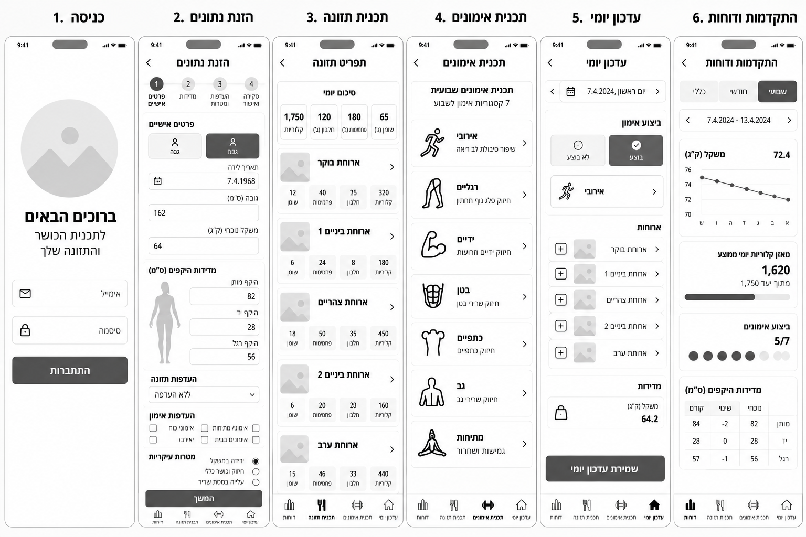
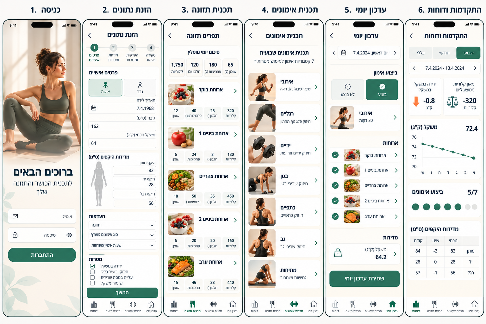
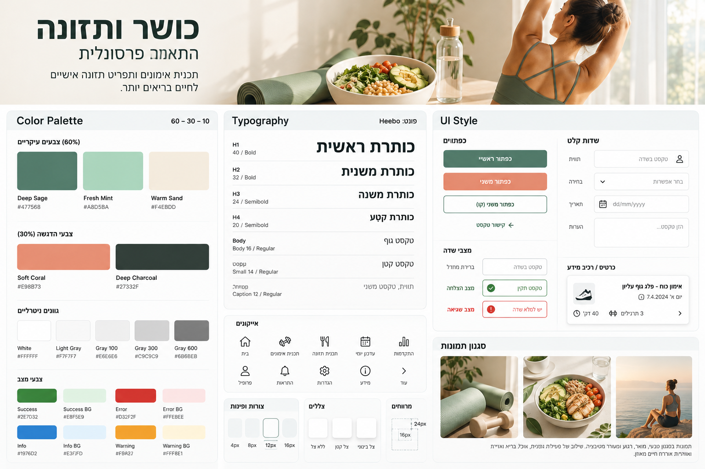

# DESIGN – כושר ותזונה: התאמה פרסונלית

**מקורות:** `wireframes.png`, `mockups.png`, `style-guide.png`, `PRD.md`, `ARCHITECTURE.md`
**סטטוס:** טיוטה מעודכנת לאישור

> **איך לקרוא:**
> - המסמך נכתב לפי מסכי המובייל הנוכחיים. כל הבדל מהתמונות מרוכז בטבלה הבאה, והמסמך גובר על התמונות במקומות האלה.
> - **"לא מופיע בתמונות"** מסמן דבר שה-PRD דורש ושאין לו מסך בתמונות.
> - **"הנחה"** מסמן החלטה שלא נקבעה בתמונות או ב-PRD.
> - הממשק בעברית ומימין לשמאל (`dir="rtl"`), בניסוח שמתאים לכל מגדר.

---

## הבדלים מהתמונות (החלטות)

| בתמונות | ב-DESIGN | סיבה |
|---------|-----------|-------|
| מטרות אחרות בכל תמונה | ירידה במשקל, חיזוק וכושר כללי, שמירה על משקל | החלטת בעלת המוצר |
| תאריך הלידה מוצג בכל שלב | הזנה בתאריך לידה, ובכל תצוגה אחרת מוצג גיל עדכני | החלטת בעלת המוצר |
| העדפת תזונה בבחירה אחת | כמה בחירות: ללא העדפות, צמחוני, טבעוני, ללא גלוטן | החלטת בעלת המוצר |
| "העדפת אימון" ו"שעות אימון" | לא קיימים ב-MVP | "העדפת אימון" לא ב-PRD. שעות אימון הן Should |
| אין שדה מספר אימונים | "כמה אימונים בשבוע" בשלב 3 | החלטת בעלת המוצר |
| "יום ראשון, 7.4.2024" בעדכון יומי | `7.4.2024` בלבד | החלטת בעלת המוצר |
| "בוצע" ו"לא בוצע" | בוצע מלא, בוצע חלקי, לא בוצע | החלטת בעלת המוצר |
| כפתור `+` בכל ארוחה | סימון וי בכל ארוחה, וכפתור `+` אחד ברמת היום | החלטת בעלת המוצר |
| 7 קטגוריות אימון | 6 ב-MVP. מתיחות ב-1.1 | Should לפי ה-PRD |
| אנשים בתמונות הקטגוריות, ותמונות של מנות | תמונה קבועה לכל קטגוריה ולכל סוג ארוחה, בלי תמונה לכל מנה | ההרכב מגיע מהמאגר, ואין לו תמונות |
| לשוניות "שבועי", "חודשי", "כללי" | ב-MVP רק "שבועי", בלי שורת לשוניות | Should, גרסה 1.1 |
| טבלת מדידות היקפים | ב-1.1 | דורשת מדידות חוזרות |
| ביצוע אימון 5/7 | אימונים שבוצעו מול המספר שתוכנן, למשל 3/4 | החלטת בעלת המוצר |
| אין דרך לפרופיל וליציאה | אייקון משתמש בכותרת | החלטת בעלת המוצר |
| ירוק כהה יותר בכפתורים | Deep Sage `#477568` | מדריך הסגנון |

---

# חלק 1: Screens

## תמונות

**Wireframes** (מבנה ותוכן):



**Mockups** (המראה הסופי):



## רכיבים משותפים

### כותרת מסך
- חץ חזרה בצד ימין, כותרת המסך במרכז, ו**אייקון משתמש** בצד שמאל.
- לחיצה על אייקון המשתמש פותחת תפריט קטן עם שתי פעולות: "הנתונים שלי" (פותח את **הזנת נתונים**) ו"יציאה" (לא מופיע בתמונות).
- במסך הכניסה אין כותרת מסך.

### סרגל ניווט תחתון
- ארבעה פריטים, מימין לשמאל: עדכון יומי, תכנית אימונים, תכנית תזונה, דוחות.
- לכל פריט אייקון מעל התווית. הפריט הפעיל באייקון מלא וטקסט מודגש בצבע Deep Sage.
- הסרגל לא מופיע בכניסה. בהזנת נתונים הוא מופיע רק למי שכבר יש לו פרופיל (הנחה).

### הודעת בטיחות
טקסט קטן בתחתית מסך הכניסה, ורק שם. הנוסח ב-`PRD.md` סעיף 3.

### מצבים משותפים (לא מופיעים בתמונות)
| מצב | איך נראה | איפה |
|-----|----------|------|
| **טעינת מסך** | במרכז המסך גלגל מסתובב (טבעת Gray 100 עם קטע Deep Sage) והטקסט "הנתונים בטעינה" ב-Deep Charcoal. מוצג עד שהנתונים מגיעים, ואז מתחלף בתוכן. עם הגדרת "הפחתת תנועה" הגלגל מסתובב לאט יותר (החלטת בעלת המוצר ב-M4) | כל מסך שפונה לפונקציה |
| **המתנה ליצירת תכנית** | כרטיס עם רקע Info BG, אייקון מידע והטקסט "התכנית בהכנה. זה עשוי לקחת כמה שניות". הכפתור שהופעל מושבת | הזנת נתונים, תכנית תזונה, דוחות |
| **אין עדיין תכנית** | כרטיס עם הטקסט "עדיין אין תכנית. אפשר ליצור אותה עכשיו" וכפתור ראשי "יצירת תכנית" | תכנית תזונה, תכנית אימונים, עדכון יומי |
| **שגיאה** | כרטיס עם רקע Error BG, אייקון שגיאה והודעה בטקסט. התכנית הקודמת נשארת מוצגת | כל מסך שפונה לפונקציה |
| **שגיאת שדה** | מסגרת אדומה, אייקון שגיאה והודעה מתחת לשדה | כל טופס |

---

## מסך: כניסה

**מטרה:** כניסה למערכת באימייל וסיסמה.

**מה יש במסך:**
- תמונה קבועה בחלק העליון.
- כותרת "ברוכים הבאים" ומשפט "לתכנית הכושר והתזונה שלך".
- שדה "אימייל" (אייקון מעטפה).
- שדה "סיסמה" (אייקון מנעול, וכפתור עין להצגת הסיסמה).
- כפתור ראשי "התחברות".
- הודעת הבטיחות, בתחתית המסך.

**מה קורה:**
- כניסה תקינה: משתמש בלי פרופיל עובר ל-**הזנת נתונים**, ומשתמש עם פרופיל ל-**עדכון יומי**.
- פרטים שגויים: הודעת שגיאה, ללא פירוט מה שגוי.
- משתמש לא מחובר שנכנס לכל מסך אחר מופנה לכאן.

---

## מסך: הזנת נתונים

**מטרה:** הזנה של הנתונים האישיים, ההעדפות והמטרה, שעל בסיסם ה-AI יוצר את התכנית והתפריט.

**מבנה:** אשף של 4 שלבים, עם מחוון שלבים בראש המסך וכפתור ראשי "המשך" בתחתית.

| שלב | שם | שדות |
|-----|----|------|
| 1 | פרטים אישיים | שם (לא מופיע בתמונות), מין (שני כפתורי בחירה: אישה, גבר), תאריך לידה, גובה (ס"מ), משקל נוכחי (ק"ג) |
| 2 | מדידות | מבנה גוף (לא מופיע בתמונות), והיקף מותן, יד ורגל בס"מ, ליד איור צללית לפי המין שנבחר (אישה או גבר), שמסמן איפה מודדים את היקף היד, המותן והרגל |
| 3 | העדפות ומטרות | העדפות תזונה (תיבות סימון), רמת כושר נוכחית (בחירה), כמה אימונים בשבוע (בחירה, 1 עד 7), מטרה עיקרית (שלושה כפתורי רדיו) |
| 4 | סקירה ואישור | סיכום כל הנתונים, כולל הגיל המחושב ולא תאריך הלידה, עם אפשרות לחזור לשלב. כפתור ראשי "שמירה ויצירת תכנית", או "שמירה" כשכבר יש תכנית (לא מופיע בתמונות) |

**מה קורה:**
- שדה חסר או ערך מחוץ לטווח (`PRD.md` 4.1): הודעה מתחת לשדה, והמעבר לשלב הבא נחסם.
- **מעבר בין שלבים:** משתמש חדש עובר בין שלבים רק בכפתור "המשך" (וחוזר בחץ החזרה), עד השמירה הראשונה. למשתמש שיש לו פרופיל, כולל מיד אחרי השמירה הראשונה, מספרי השלבים במחוון לחיצים, ולחיצה עוברת ישר לשלב. בשמירה נבדקים כל השדות. שדה לא תקין: האשף עובר לשלב שלו ומציג הודעה ליד השדה, ושום דבר לא נשמר.
- **יציאה עם שינויים שלא נשמרו:** אם שונה נתון ולא נשמר, ומנסים לעבור למסך אחר (סרגל תחתון, חץ החזרה, "הנתונים שלי" או "יציאה"), נפתח חלון "יש שינויים שלא נשמרו" עם שלושה כפתורים: "שמירה ומעבר" (שדה לא תקין: נשארים באשף עם הודעה ליד השדה), "מעבר בלי שמירה" ו"ביטול". בסגירת הלשונית או במעבר לכתובת אחרת מוצגת אזהרת הדפדפן עצמו. בלי שינוי, אין חלון.
- "ללא העדפות" לא משולב עם העדפה אחרת: בחירה בו מבטלת את האחרות, ובחירה באחרת מבטלת אותו.
- ליד "ללא גלוטן": "לא מתאים לצליאק או לאלרגיה".
- BMI נמוך מ-18.5: "ירידה במשקל" מושבתת, עם הסבר "לא זמין לפי הגובה והמשקל שהוזנו".
- **שמירה כשעוד אין תכנית** (בדרך כלל השמירה הראשונה): הנתונים נשמרים, מוצג מצב המתנה, ובסיומו עוברים ל-**תכנית תזונה**. אם היצירה נכשלה: הודעת שגיאה וכפתור "יצירת תכנית". גם שמירה נוספת, כל עוד אין תכנית, יוצרת אותה (החלטת בעלת המוצר ב-M4). הכפתור בשלב 4: "שמירה ויצירת תכנית".
- **שמירה כשכבר יש תכנית:** הנתונים נשמרים בלבד. השינוי ישפיע על התכנית הבאה, בסוף המחזור, והמסך מציין זאת (הנחה). הכפתור בשלב 4: "שמירה".

---

## מסך: תכנית תזונה

**מטרה:** להציג את התפריט היומי המחולק לארוחות, עם כמויות וערכים תזונתיים.

**מה יש במסך:**
- **כרטיס "סיכום יומי":** ארבעה אריחים: קלוריות, חלבון (גרם), פחמימות (גרם), שומן (גרם). מתחתם יעד החלבון מול הערך בתפריט (לא מופיע בתמונות).
- **חמישה כרטיסי ארוחה:** ארוחת בוקר, ארוחת ביניים 1, ארוחת צהריים, ארוחת ביניים 2, ארוחת ערב. בכל כרטיס: תמונה קבועה, שם הארוחה, חץ, ושורת ערכים: קלוריות, חלבון, פחמימות, שומן.
- לחיצה על כרטיס פותחת בתוכו את רשימת הרכיבים, עם כמות בגרמים לכל רכיב (לא מופיע בתמונות).

**מה קורה:**
- המסך קריאה בלבד. התפריט אחד לכל ימי המחזור, ולכן אין בורר תאריך.
- בלי תכנית: מצב **אין עדיין תכנית**.

---

## מסך: תכנית אימונים

**מטרה:** להציג את התכנית השבועית, לפי קטגוריות ובלי חלוקה לימים.

**מה יש במסך:**
- **כרטיס פתיחה:** "תכנית אימונים שבועית", ומתחתיו "6 קטגוריות · N אימונים בשבוע", לפי המספר שתוכנן.
- **שישה כרטיסי קטגוריה:** אירובי, רגליים, ידיים, בטן, כתפיים, גב. בכל כרטיס: תמונה קבועה, שם, תיאור קצר וחץ.
- לחיצה על כרטיס פותחת בתוכו את התרגילים (לא מופיע בתמונות):
  - **אירובי:** שם התרגיל ומשך, למשל "30 דקות הליכה מהירה".
  - **כוח:** סטים וחזרות ושם התרגיל, למשל "3x12 סקוואט".

**מה קורה:**
- המסך קריאה בלבד. אין לשוניות ימים, אין ימי מנוחה ואין "סימון כבוצע".
- האפליקציה לא מתייחסת למקום האימון.
- בלי תכנית: מצב **אין עדיין תכנית**.

---

## מסך: עדכון יומי

**מטרה:** דיווח של יום, וקבלת מאזן הקלוריות מיד אחרי השמירה.

**מה יש במסך:**
- **בורר תאריך:** חיצים ואייקון לוח שנה, והתאריך בלבד, למשל `7.4.2024`. ברירת מחדל היום. אפשר לבחור ימים קודמים, ולא ימים עתידיים.
- **כרטיס "ביצוע אימון":** שלושה כפתורי בחירה: **בוצע מלא**, **בוצע חלקי**, **לא בוצע**.
  - ב"בוצע חלקי" נפתחת רשימה של הקטגוריות בתיבות סימון, ומסמנים מה בוצע.
  - אין שדות דקות, חזרות או משקל.
- **כרטיס "ארוחות":** חמש שורות, אחת לכל ארוחה בתפריט: תיבת וי, תמונה קבועה, שם הארוחה והקלוריות. סימון וי משמעותו שהארוחה נאכלה לפי התפריט.
- **כפתור `+` "הוספת מזון או שתייה",** אחד ברמת היום, מתחת לשורות הארוחות. הוא פותח אזור עם חיפוש במאגר, שדה כמות בגרמים וכפתור "הוספה". כל פריט נוסף מוצג בשורה עם שם, קלוריות וכפתור × להסרה.
- **כרטיס "משקל":** שדה ק"ג.
- **כפתור ראשי "שמירת עדכון יומי".**

**מאזן קלוריות (לא מופיע בתמונות):** אחרי שמירה מוצג בראש המסך כרטיס עם שני ערכים: **היום** ו-**אתמול**. ליד כל ערך סימן (+ או −) ומילה ("עודף" או "גרעון"). אין נתוני אתמול: מוצג רק היום. הטופס נשאר ניתן לעריכה.

**מה קורה:**
- "בוצע חלקי" בלי קטגוריה, או משקל מחוץ לטווח: הודעת שגיאה, והשמירה נחסמת.
- מזון שלא נמצא במאגר לא ניתן להוספה.
- שמירה חוזרת על אותו תאריך מחליפה את הנתונים.
- בלי תכנית: מצב **אין עדיין תכנית**.

---

## מסך: התקדמות ודוחות

**מטרה:** להציג את הדוח השבועי, לאסוף פידבק, ולהציג תכנית ותפריט מעודכנים יחד עם הדוח.

**מה יש במסך (MVP):**
- **בורר שבוע:** חיצים וטווח תאריכים, למשל `7.4.2024 - 13.4.2024`.
- **שני אריחי מדד:** שינוי במשקל (ק"ג) ומאזן קלוריות ממוצע ליום.
- **כרטיס משקל:** הערך האחרון וגרף קו בסיסי ב-SVG, עם טבלה לצדו לקורא מסך.
- **כרטיס "ביצוע אימונים":** מספר שבוצע מתוך המתוכנן (למשל 3/4), ונקודות בכמות המתוכננת. נקודה מלאה לכל אימון שבוצע. במחזור שאינו בן 7 ימים מוצג רק המספר שבוצע.

**מה נוסף ונדרש לפי ה-PRD (לא מופיע בתמונות):**
- **צריכת קלוריות ומאזן:** טבלה, שורה לכל יום.
- **קטגוריות שבוצעו:** רשימה עם מספר הפעמים.
- **טקסט סיכום** קצר של ה-AI, בכרטיס. אם לא התקבל פידבק, מצוין "לא התקבל פידבק".
- **טופס פידבק:** שני שדות טקסט, "פידבק על האימונים" ו"פידבק על התפריט", עד 500 תווים בכל אחד, וכפתור קו "שמירת פידבק".
- **כפתור "סיום מחזור וקבלת תכנית חדשה":** כפתור ראשי. פעיל מהיום שאחרי סוף המחזור, ומושבת לפני כן עם הסבר "המחזור הנוכחי טרם הסתיים".
- **התכנית המעודכנת:** אחרי הלחיצה מצב המתנה, ואז הדוח וכרטיס "התכנית והתפריט המעודכנים" עם הקישורים "לתכנית תזונה" ו"לתכנית אימונים".

**מה בכל גרסה:**

| רכיב | MVP | Should (1.1) |
|------|-----|---------------|
| לשוניות "חודשי" ו"כללי" | | כן |
| אריח BMI | | כן |
| גרף משקל | בסיסי | מלא |
| גרפי קלוריות ומאזן | טבלה | גרפים |
| טבלת מדידות היקפים (נוכחי, שינוי, קודם) | | כן |

**מה קורה:**
- בחירת שבוע מציגה דוח של מחזור קודם, כולל הפידבק שנשמר.
- ימים שלא הוזנו: הדוח מחושב מהימים שהוזנו.
- כשל ביצירת התכנית: הודעת שגיאה, והתכנית הקודמת נשארת בתוקף.

---

## הניווט בין המסכים

```
כניסה ──► (אין פרופיל) הזנת נתונים ──► תכנית תזונה
   └────► (יש פרופיל)  עדכון יומי

סרגל תחתון, בכל מסך חוץ מכניסה:
  עדכון יומי  ↔  תכנית אימונים  ↔  תכנית תזונה  ↔  דוחות

אייקון משתמש ──► הנתונים שלי (הזנת נתונים)
             └─► יציאה ──► כניסה

דוחות ──(סיום מחזור)──► דוח + תכנית מעודכנת ──► תכנית תזונה / תכנית אימונים
```

מסך מנהל מערכת אינו ב-MVP (גרסה 1.3), ואינו מופיע בתמונות.

## התנהגות במחשב

התמונות מציגות מובייל בלבד. במחשב התוכן נשאר בעמודה אחת במרכז המסך, ברוחב עד 560px, והסרגל התחתון נשאר (הנחה).

---

# חלק 2: Style Guide

## תמונה



## האווירה הכללית

רגועה, טבעית ומוארת. ירוק עדין, חול חם ולבן, כרטיסים לבנים עם פינות מעוגלות, מרווחים נדיבים, ותמונות טבעיות של פעילות, אוכל בריא ואווירה מאוזנת.

## צבעים

| קבוצה | שם | HEX | שימוש |
|-------|----|-----|-------|
| **עיקריים (60%)** | Deep Sage | `#477568` | כפתור ראשי, פריט ניווט פעיל, מסגרת וטקסט של כפתור קו, קישורים |
| | Fresh Mint | `#A8D5BA` | אייקון פחמימות. צבע משלים |
| | Warm Sand | `#F4EBDD` | רקע חם לאזורים רחבים |
| **הדגשה (30%)** | Soft Coral | `#E98B73` | כפתור משני, אייקון קלוריות |
| | Deep Charcoal | `#27332F` | טקסט ראשי, כותרות, טקסט על כפתור משני, ערכי המאזן |
| **ניטרליים** | White | `#FFFFFF` | רקע דף וכרטיסים |
| | Light Gray | `#F7F7F7` | רקע אריחים ובחירות לא פעילות |
| | Gray 100 | `#E6E6E6` | קווי הפרדה |
| | Gray 300 | `#C9C9C9` | קווים דקורטיביים (לא גבול שדה) |
| | Gray 600 | `#6B6B6B` | טקסט משני וגבולות שדות |
| **מצב** | Success | `#2E7D32` | הצלחה, קווי גרף |
| | Success BG | `#E8F5E9` | רקע הודעת הצלחה |
| | Error | `#D32F2F` | שגיאה |
| | Error BG | `#FFEBEE` | רקע הודעת שגיאה |
| | Info | `#1976D2` | מידע, אייקון חלבון |
| | Info BG | `#E3F2FD` | רקע הודעת מידע ומצב המתנה |
| | Warning | `#F9A827` | אזהרה, אייקון שומן |
| | Warning BG | `#FFF8E1` | רקע הודעת אזהרה |

שלושה קודים במדריך לא היו קריאים, והערכים האלה אושרו: Gray 600, Info BG ו-Warning.

### כללי שימוש בצבע

- **אריח ערך תזונתי:** רקע Light Gray, ואייקון בצבע הקטגוריה. לכל אריח תווית טקסט.
- **מאזן קלוריות:** הערך ב-Deep Charcoal, עם סימן (+ או −) ומילה ("עודף" או "גרעון"). **בלי ירוק ואדום,** כי גרעון הוא בדיוק המטרה של מי שרוצה לרדת במשקל.
- **גרף ב-MVP:** קו המשקל ב-Success. בגרסה 1.1, גם מאזן בגרף משתמש בצבע ניטרלי לשני הכיוונים.
- **הודעות מצב:** צבע המצב משמש לרקע ולאייקון, והטקסט ב-Deep Charcoal.
- **צבע לא מועבר לבדו:** ליד כל צבע יש מילה, סימן או אייקון.

### ניגודיות

הנדרש: 4.5:1 לטקסט, 3:1 לגבולות של רכיבי ממשק.

| שילוב | יחס | החלטה |
|-------|-----|--------|
| לבן על Deep Sage (כפתור ראשי) | 5.2:1 | עובר. הטקסט בכפתור הראשי לבן |
| לבן על Soft Coral (כפתור משני במדריך) | 2.5:1 | **נכשל.** הטקסט בכפתור המשני ב-Deep Charcoal |
| Deep Charcoal על Soft Coral | 5.3:1 | עובר |
| Gray 300 על לבן (גבול שדה במדריך) | 1.7:1 | **נכשל.** גבול שדה ב-Gray 600 |
| Gray 600 על לבן | 5.3:1 | עובר (טקסט משני וגבול שדה) |
| Deep Charcoal על לבן | 13.1:1 | עובר |
| Warning על Warning BG | 1.9:1 | **נכשל.** לא משמש כטקסט |
| Info על Info BG | 4.0:1 | **נכשל.** לא משמש כטקסט |
| Error על Error BG | 4.4:1 | **נכשל בקושי.** לא משמש כטקסט |
| Deep Sage על Warm Sand | 4.4:1 | **נכשל בקושי.** על Warm Sand הטקסט ב-Deep Charcoal |

## גופנים

גופן אחד: **Heebo** (תומך בעברית, זמין ב-Google Fonts).

| סגנון | גודל | משקל | שימוש |
|-------|------|------|--------|
| H1 | 40px | Bold | "ברוכים הבאים" במסך הכניסה |
| H2 | 32px | Bold | כותרת גדולה |
| H3 | 24px | Semibold | כותרת מסך במובייל (הנחה) |
| H4 | 20px | Semibold | כותרת כרטיס |
| Body | 16px | Regular | טקסט גוף |
| Small | 14px | Regular | טקסט קטן |
| Caption | 12px | Regular | תווית וטקסט משני |

## כפתורים

| סוג | מראה | שימוש |
|-----|-------|--------|
| **ראשי** | רקע Deep Sage, טקסט לבן מודגש | "התחברות", "המשך", "שמירת עדכון יומי" |
| **משני** | רקע Soft Coral, טקסט Deep Charcoal מודגש | פעולה משנית |
| **משני (קו)** | רקע לבן, מסגרת וטקסט Deep Sage | "שמירת פידבק", "הוספת מזון או שתייה" |
| **קישור טקסט** | טקסט Deep Sage עם חץ | "לתכנית תזונה" |
| **בחירה** | נבחר: רקע Deep Sage וטקסט לבן עם סימון וי. אחר: רקע Light Gray | שלושת כפתורי האימון, מין |

- הכפתורים ברוחב מלא בטפסים. כפתור מושבת ב-Gray 100 עם טקסט Gray 600.

## שדות קלט

תווית מעל השדה. השדה: רקע לבן, מסגרת Gray 600 (במדריך Gray 300, שונה בגלל ניגודיות), טקסט חלופי ב-Gray 600.

| סוג | איך נראה |
|-----|-----------|
| טקסט | אייקון בצד ימין (בכניסה: מעטפה, מנעול) |
| בחירה | חץ למטה בצד שמאל, הטקסט "בחירת אפשרות" |
| תאריך | אייקון לוח שנה, והתבנית `dd/mm/yyyy` |
| טקסט ארוך | שדה גבוה, הטקסט "כאן כותבים..." |
| תיבת סימון | ריבוע עם סימן וי כשנבחר, התווית מימין |
| רדיו | עיגול, התווית מימין |

**מצבי שדה:**

| מצב | מסגרת | תוכן |
|-----|--------|-------|
| ברירת מחדל | אפורה | טקסט בשדה |
| הצלחה | ירוקה (Success) | אייקון וי בעיגול |
| שגיאה | אדומה (Error) | אייקון "!" בעיגול והודעה, למשל "יש למלא שדה" |

## כרטיסים ורכיבים

- **כרטיס:** רקע לבן, פינות 12px, צל קטן. הכותרת ב-H4.
- **אריח ערך:** אייקון, תווית ומספר עם יחידה.
- **כרטיס ארוחה:** תמונה קבועה, שם, חץ, שורת ערכים ואזור רכיבים שנפתח.
- **כרטיס קטגוריה:** תמונה קבועה, שם, תיאור, חץ ואזור תרגילים שנפתח.
- **מחוון שלבים:** עיגולים ממוספרים. שלב פעיל ברקע Deep Sage.
- **שורת רשימה עם ×:** שם, ערך וכפתור × להסרה.
- **כרטיס מצב:** רקע ה-BG של המצב, אייקון והודעה.
- **גרף:** כותרת מעל, צירים ותוויות, עם טבלה חלופית לקורא מסך.

## אייקונים

אייקוני קו דקים, בצבע Deep Charcoal, מספריית אייקונים חינמית. אין צורך לספק קבצים.

| אייקון | משמש ב-MVP |
|--------|-------------|
| עדכון יומי (בית) | ניווט, כמו בתמונות |
| תכניות אימונים (משקולת) | ניווט |
| תכנית תזונה (מזלג וסכין) | ניווט |
| התקדמות (עמודות) | ניווט |
| פרופיל (משתמש) | כותרת מסך |
| לוח שנה | בורר תאריך, שדה תאריך |
| מידע | כרטיס מידע ומצב המתנה |
| חץ | חזרה, בוררים וכרטיסים |
| מעטפה, מנעול, עין | מסך הכניסה |
| להבה, טיפה, שיבולת | אריחי הערכים התזונתיים |

## צורות ופינות

ארבעה רדיוסים במדריך: 4px, 8px, **12px**, 16px.
- כרטיסים: 12px.
- כפתורים ושדות: 8px (הנחה).

## צללים

שלוש רמות במדריך: ללא צל, צל קטן, צל בינוני.
- כרטיסים: צל קטן.
- תפריט המשתמש ומצב המתנה: צל בינוני (הנחה).

## מרווחים

**16px** ריפוד של מסך וכרטיס במובייל, ו-**24px** בין קטעים (הנחה, לפי הדיאגרמה במדריך).

## תמונות

סגנון: טבעי, מואר, רגוע ומעורר מוטיבציה.

תמונות הארוחות והקטגוריות מוצגות במלואן, בלי חיתוך. תמונת מסך הכניסה מוצגת כפס חתוך בראש המסך.

**התמונות מסופקות על ידי בעלת המוצר, בתיקיית `images/`:**

| קובץ | מקום | טקסט חלופי (alt) | מתי נדרש |
|------|-------|-------------------|----------|
| `login.jpg` | מסך הכניסה | "ציוד כושר וקערת סלט על שולחן" | לפני בניית M2 |
| `aerobic.jpg` | קטגוריית אירובי | "גבר ואישה רצים בפארק" | לפני בניית M4 |
| `legs.jpg` | קטגוריית רגליים | "אימון רגליים" | לפני בניית M4 |
| `arms.jpg` | קטגוריית ידיים | "אימון ידיים עם משקולת" | לפני בניית M4 |
| `abs.jpg` | קטגוריית בטן | "אימון בטן" | לפני בניית M4 |
| `shoulders.jpg` | קטגוריית כתפיים | "אימון כתפיים" | לפני בניית M4 |
| `back.jpg` | קטגוריית גב | "אימון גב" | לפני בניית M4 |
| `breakfast.jpg` | ארוחת בוקר | "ארוחת בוקר בריאה" | לפני בניית M4 |
| `snack_1.jpg` | ארוחת ביניים 1 | "חטיף בריא" | לפני בניית M4 |
| `lunch.jpg` | ארוחת צהריים | "ארוחת צהריים בריאה" | לפני בניית M4 |
| `snack_2.jpg` | ארוחת ביניים 2 | "חטיף בריא" | לפני בניית M4 |
| `dinner.jpg` | ארוחת ערב | "ארוחת ערב בריאה" | לפני בניית M4 |

תמונת מתיחות נוספת תידרש בגרסה 1.1. תמונות הארוחות הן לאווירה בלבד, ואינן מתארות את ההרכב בפועל. תמונת הגב מציגה מכשיר כבלים, אף שהתכנית כוללת רק משקל גוף ומשקולות יד (החלטת בעלת המוצר).

הקבצים המקוריים בגודל מלא נשמרים ב-`images-original/`, שאינה נכנסת לריפו.

## נגישות

- ניגודיות לפי הטבלה למעלה.
- תווית גלויה לכל שדה, מקושרת אליו.
- ניווט מלא במקלדת, עם מסגרת פוקוס ברורה (Deep Sage, 2px, הנחה).
- מצב לא מועבר בצבע בלבד.
- לכל גרף יש טבלה חלופית.
- `dir="rtl"` ו-`lang="he"` בכל דף.

---

## נקודות פתוחות

| # | נושא | הערה |
|---|------|------|
| 1 | קובצי התמונות | בעלת המוצר מספקת, לפי המועדים בטבלה |
| 2 | תיאור קצר לכל קטגוריית אימון | ייקבע עם `exercises.json`, לפי הנוסח שבתמונות |
| 3 | מסכים שנכתבו כ"לא מופיע בתמונות" | אין צורך בתמונות נוספות. אם יסופקו, הן ייבדקו מול המסמך |
